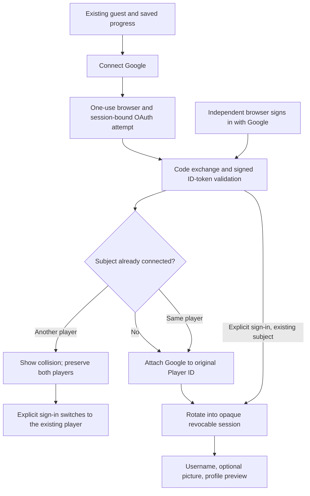

# Player identity, linking and recovery

Implementation milestone, 2026-11-04. Local validation is recorded in [the QA report](PLAYER_IDENTITY_PERSISTENCE_QA_REPORT.md). Real Google consent and deployed R2 storage require owner setup and are not implied by fixture results.

## One permanent player

Player remains the single identity and foreign-key parent for wallet ledger, inventory/equipment, XP/stats, achievements, matches and CuisineProgress. Linking Google changes its kind to REGISTERED; it does not move or recreate any progression records. ExternalIdentity is unique by provider/subject and by player/provider. Email is never an account lookup key. Google email, name, profile picture, access/refresh tokens and authorization codes are not retained.

## Authentication and sessions

The existing jose/Web Crypto stack implements Google's server-side OIDC authorization-code flow. State and nonce are 256-bit random values; PKCE uses S256. OAuthAttempt lasts ten minutes and binds state hash, a separate httpOnly browser-cookie hash, the initiating session fingerprint and link actor. An atomic consumedAt update prevents callback replay before code exchange. Starting another attempt replaces the transaction cookie. Cancellation/error consumes the attempt without linking.

Only configured AUTH_ORIGIN can start or receive callbacks. Return destinations are fixed `/account` and `/profile`; no request-provided redirect target is used. Production provider/token/JWKS URLs are fixed Google HTTPS endpoints. ID-token RS256 signature, issuer, audience, authorized party when present, expiry, issued-at age, nonce, subject and verified-email claim are checked. Email has no linking authority. Network waits have deadlines and redirects are rejected during token exchange.

The same `pw_session` cookie supports legacy signed guest cookies and new `s1_` opaque registered sessions. Only SHA-256 hashes of registered secrets are stored in AccountSession. Cookies are httpOnly, SameSite=Lax, host-only, path `/`, and Secure when the configured public site is HTTPS. Session lifetime is 30 days; new logins clean expired sessions and retain at most 20 active sessions per player. Linking rotates the session and invalidates old guest cookies by checking Player.kind. Registered identity comes from the DB, not browser names or JWT kind. A DB outage fails authentication closed when an existing cookie needs lookup, returns a retryable 503 from session APIs, and cannot silently overwrite that cookie with a new guest; fresh guests without a database can still use legacy guest play. Do not promise database-outage session continuity.

Account settings list creation/expiry/current-browser status without session hashes. Sign out revokes the current registered session and clears its cookie; sign out other browsers revokes all except current. API ownership is always derived from the authenticated session. Realtime tokens include an internal session hash; the Node service checks registered sessions at handshake and before each incoming packet. Already connected legacy guest sockets lose access after linking. A revoked idle socket is rejected on its next packet; it is not proactively evicted immediately. Guest logout only clears the browser's legacy bearer cookie; a stolen old guest JWT cannot be individually revoked before linking/expiry. Never claim otherwise.

## Usernames and public profile

Usernames are optional until registered onboarding: 3-20 ASCII letters/numbers, single underscores only between words. They canonicalize explicitly to lowercase; leading/trailing whitespace is rejected. Reserved system/admin/platform and an initial inappropriate-name denylist are blocked. This list is not a complete moderation system. Unique canonical storage plus a lowercase/format SQL CHECK prevents case collisions, including concurrent claims. A player-row lock enforces a 30-day rename interval. Display name remains separate and nonunique; guest display names are not verified administrator identities.

Availability checks are authenticated and disclose only available/unavailable plus the canonical name. This necessarily reveals public username availability, not provider/email membership. Profile, generic leaderboards and navigation display the saved username/picture; historical match display names remain unchanged. All identity mutation schemas reject client-supplied ownership fields.

## Avatars: Node decoding, private R2 storage

The browser uploads raw JPEG/PNG/WebP to the authenticated same-origin proxy. The proxy bounds actual bytes to 5 MB and sends a 30-second, purpose/audience-bound signed job to the existing realtime `/internal/avatar` endpoint. That service rejects unsigned/replayed jobs, limits processing to two concurrent requests, checks magic bytes against MIME, decodes with Sharp/libvips, limits input pixels and each dimension to 4096, rejects multiple frames, applies orientation/crop, strips metadata and generates 64px/256px square sRGB WebP. Originals and filenames are never stored. A filename extension is ignored; decoded bytes and MIME must agree. Decoding does not run in a Worker, and no paid Images service is used.

The Worker writes only normalized variants to private R2 binding `AVATARS`. Random 128-bit object keys cannot be chosen by the browser. A player-row lock atomically replaces the current reference; old objects are deleted after commit. Failed DB saves clean the new objects. Deletion failures emit a fixed cleanup warning and may leave unreachable orphan objects; operational cleanup must compare bucket prefixes to current Player.avatarKey references. Public image reads require a currently referenced key and serve a fixed WebP type with nosniff, same-origin resource policy and sandbox CSP. Removed keys return 404; previously cached public avatar bytes may remain for their five-minute cache TTL. Pictures are public presentation, not private media. Default initials remain on missing/failed image loads.

Local fixture mode uses real local filesystem objects and the same Node decoder, not R2. Its use does not verify deployed R2 storage. It requires IDENTITY_TEST_MODE=1, loopback HTTP AUTH_ORIGIN and a loopback database ending `_test`; the same guard gates the controlled local provider. There is no production test-login endpoint or raw claim bypass. Production Google/R2 configuration must never enable fixture mode.

## Security and operational boundaries

Sensitive identity routes use database-backed fixed-window counters shared across Worker instances, as well as same-origin checks on mutations. State/attempt/session secrets are never logged. Counter keys hash the bucket and IP/player; no raw IP is stored there. Expired counters require periodic cleanup; see setup. Limits are abuse damping, not bot/Sybil prevention. Expired/consumed OAuth attempts are purged on a subsequent OAuth start.

The shared Player lock serializes linking, username claims, sessions, avatar references and economic writers. No automatic account merge, provider unlink or self-service deletion is implemented. Support/contact deletion remains the channel; retention/backup policy and a future deletion workflow need separate work. Database migrations must precede the future approved release because profile/session reads now expect identity columns. Deployment, external dashboards, secrets, DNS and production verification are outside this local milestone.

Sources: [Google OIDC](https://developers.google.com/identity/openid-connect/openid-connect), [Google web-server OAuth](https://developers.google.com/identity/protocols/oauth2/web-server), [R2 Workers API](https://developers.cloudflare.com/r2/api/workers/workers-api-reference/), [Sharp constructor limits](https://sharp.pixelplumbing.com/api-constructor/), [Sharp output metadata defaults](https://sharp.pixelplumbing.com/api-output/). These support protocol/platform choices; implementation claims above require this repository's tests.
