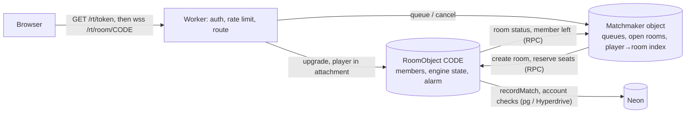

# Cloudflare Durable Objects as a replacement for the Railway realtime server

Should the Railway Socket.IO server (`apps/realtime`) be replaced with Durable Objects? This is an assessment only. No object, namespace or deployment was created, and no code was changed.

**Verdict: technically feasible, but not a drop-in replacement. It doesn't pay for itself on cost.**
- **At today's scale** it saves at most the $5 Railway fee, and only if Workers Paid is bought anyway.
- **At every larger scale modelled,** it costs more than Railway with WebSocket compression turned on.
- **It drops the long-polling fallback,** which the takeover added to fix real connection failures.
- **It needs about 5–7 weeks of engineering** and a replacement for the avatar processor.
- **Recommendation:** keep Railway for now; revisit only if the conditions in `INFRASTRUCTURE_COST_DECISION.md` change.

## What the platform provides (official documentation, read 2026-11-14)

| Topic | Fact | Source |
|---|---|---|
| Native WebSockets and hibernation | The Hibernation API "allows the Durable Object to hibernate without disconnecting clients when idle". Pings get automatic pongs without waking the object | [WebSockets best practices](https://developers.cloudflare.com/durable-objects/best-practices/websockets/) (2026-10-30) |
| What prevents hibernation | Pending `setTimeout`/`setInterval`, unfinished I/O or `waitUntil`, open outbound connections, a request still being processed, or the standard (non-hibernation) WebSocket API. Hibernation happens after about 10 s idle | [Lifecycle](https://developers.cloudflare.com/durable-objects/concepts/durable-object-lifecycle/) (2026-10-30) |
| State on hibernation | "the in-memory state is discarded". Per-socket attachments of at most 16,384 bytes survive while the socket stays open; everything else must be in storage | Same |
| Timers | One alarm per object; at-least-once, with retries | [Alarms](https://developers.cloudflare.com/durable-objects/api/alarms/) (2026-04-21) |
| Limits | 30 s of CPU per request or message by default (up to 5 min); a soft limit of 1,000 requests a second per object; 32 MiB received WebSocket messages; 10 GB storage per object; unlimited objects | [Limits](https://developers.cloudflare.com/durable-objects/platform/limits/) (2026-11-13) |
| Ordering | One active instance per object; handlers run one at a time (as Node's event loop does today) | [In-memory state](https://developers.cloudflare.com/durable-objects/reference/in-memory-state/) |
| Code deploys | Hibernated sockets survive a new version. Sockets on a running instance are **disconnected** by an immediate update, or when a deferred update reaches its maximum delay | Lifecycle |
| Billing | Requests: 1M a month included, then $0.15/M; incoming WebSocket messages billed 20:1; **outgoing messages free**. Duration: 400,000 GB-s included, then $12.50/M, **at 128 MB per object whatever it uses**; hibernated objects aren't billed. Free plan: SQLite-backed objects only, 100k requests and 13,000 GB-s a day, hard errors beyond | [Pricing](https://developers.cloudflare.com/durable-objects/platform/pricing/) (2026-11-13) |

**Not found in the pages read (unverified):**
- the maximum number of WebSocket connections per object;
- where an object is placed (near its first request, as commonly described, but that page wasn't read);
- whether an *outgoing* send wakes a hibernated object.

## Every Socket.IO feature the app uses, mapped

| Feature in use today | On Durable Objects | Effort |
|---|---|---|
| WebSocket transport | Native `WebSocketPair` with the Hibernation API | Small |
| **HTTP long-polling, polling-first, `tryAllTransports` fallback** | **Not provided.** It would need a custom HTTP polling or SSE protocol, where every poll is a billed request, or dropping the fallback. The takeover added polling-first because WebSocket upgrades failed behind some gateways (`docs/RELIABILITY_INVESTIGATION.md`) | **Large, or a reliability regression** |
| Handshake auth with a token | Verify the HS256 token in the Worker (jose already runs there) before forwarding the upgrade to the object; put the player in the socket attachment | Small |
| Acknowledgements with client timeouts | Your own request id → response message, and client-side timeouts | Medium (both client and server) |
| Client auto-reconnect with backoff | Your own reconnect loop in `lib/realtime/connection.ts`. Today's `seq` / `room:sync` / `game:reconnected` resync already exists and can be reused | Medium |
| Heartbeats | WebSocket protocol pings (free, no wake). Dead-peer detection needs an application ping or close handling | Small |
| Per-packet middleware (account guard every 5 s) | Run it inside the object. The database read keeps the object awake (I/O), which adds duration | Small |
| Per-category rate limits | Per socket, inside the object: the same code | Small |
| **Per-IP connection cap (30)** | Spans rooms, so it needs the Worker (Cloudflare's rate-limiting binding) or a coordinator object | Medium |
| `io.fetchSockets()` for the admin kick | Needs a player → room index, then an RPC to that room | Medium |
| `/admin/metrics` across all rooms | No global memory. A coordinator registry, or Analytics Engine | Medium |
| Room code → room | `idFromName(code)`: one object per room | Small |
| **One room per player** (`playerRoom` map) and **"session replaced" across tabs** | Global state: a coordinator or a per-player object, with a two-step join to avoid races | Medium |
| Matchmaking queues and the open-public-room list | One **matchmaker object** (per game, or global) with alarms in place of the 1 s interval | Medium |
| Reconnect grace (60 s), auto-start (5 s), sweeps, engine ticks (`nextDeadline`) | One alarm per object, multiplexing the room's deadlines. Bumper Blitz's 50 ms tick needs `setTimeout` (alarms are retried, at-least-once timers), so the object **can't hibernate during a match** | Medium |
| Room state in memory | Fine while awake. To hibernate a lobby or a turn-based game, the room must be serialised to SQLite after each change (rows written count against the Free 100,000-a-day limit) | Medium–large |
| Persisting results (`recordMatch`) and account/ban lookups | Prisma + `pg` from the object, as the Worker does now. Each wake opens a new connection; Hyperdrive could help (`NEON_HYPERDRIVE_ASSESSMENT.md`) | Small–medium |
| **Avatar normalisation (Sharp/libvips) on Railway** | **Can't run on Workers.** Options: (a) normalise in the browser (canvas → WebP) and only *validate* on the server, which is weaker: re-encoding currently strips hidden payloads; (b) a WebAssembly codec in a Worker or object, bounded by 128 MB of memory; (c) a paid image service (not authorised); (d) keep a tiny container somewhere. Custom avatars aren't live today (no R2 binding) | Medium, with a security trade-off |

**Game engines and rules don't change.** They're pure, deterministic, synchronous functions with injected time and RNG (`packages/engines`). They would run unchanged inside an object.

## Proposed design, if it were built

- **One `RoomObject` per room code.** It holds members and authoritative state, as today's `Room` class does; most of its code ports directly.
  - A real-time match keeps it awake: that's billed duration.
  - A turn-based match can hibernate between moves if its state is saved to SQLite after each action.
- **One `Matchmaker` object.** It holds queues, the open public rooms, and the **player → room index** that enforces one room per player. It also serves admin metrics. One object handles about 1,000 requests a second (soft limit), plenty for this scale, but it's a **single coordination point**.
- **The Worker** verifies tokens, applies the per-IP limits, and routes.

**Limitations:**
- **Location.** A room lives in one place, near whoever created it, while Railway serves everyone from one region. That's better for local groups and worse for players far apart in a 20 Hz Bumper Blitz match.
- **Deploys.** Sockets in active (awake) rooms are disconnected by a code update unless a deferred update waits for them. That's similar to Railway restarts today, but it only affects awake rooms.
- **Failures.** An evicted or crashed object loses unsaved in-memory state. That's one room, not every room as a Railway restart is today: **a reliability improvement.**
- **The polling fallback is lost:** a reliability regression for networks that block WebSockets.
- **Testing.** Today's real-socket integration tests (`apps/realtime/test`, 61 tests) are Socket.IO-specific. They'd need porting to the new protocol (Miniflare/workerd).

## Costs (from `docs/infrastructure-cost-model.mjs`)

Assumptions:
- **Room size:** 4.17 players per room, with an even mix of the six games.
- **Message rates:** 15.6 incoming messages a second per room.
- **Awake time:** each room is awake for its whole match; a coordinator stays awake.
- **Concurrency:** a typical month averages 30% of the peak.

The scenarios below are *rooms* (the brief's unit). Peak players are about 4 × rooms.

| Peak concurrent rooms | Average active rooms | Monthly requests (incl. 20:1 messages) | Monthly GB-s | **Workers Paid + Durable Objects** | With turn-based rooms hibernating | Workers Free + Durable Objects Free? |
|---|---|---|---|---|---|---|
| 10 (about 42 players) | 3 | 6.2M | 1.31M (incl. coordinator 0.33M) | **$17** | $13 | **No**: about 43,000 GB-s a day, against 13,000 |
| 50 (about 208 players) | 15 | 31M | 5.26M | **$70** | $50 | No |
| 100 (about 417 players) | 30 | 62M | 10.2M | **$136** | $95 | No |
| 500 (about 2,083 players) | 150 | 310M | 49.6M | **$666** | $461 | No |

Workers requests for pages are the same in every architecture and are left out.

The per-room-hour drivers: 450 GB-s of duration (128 MB × 3,600 s) costs about **$0.0056** beyond the allowance. About 2,800 requests cost about **$0.0004**. **Duration is 93% of the variable cost,** and it's set by how long rooms are awake, not by how much data they send.

**For comparison, Railway on the same load** (Hobby fee included, Workers Paid not):

| Peak concurrent rooms | Railway as configured today | Railway with `perMessageDeflate` |
|---|---|---|
| 10 | $27 | **$10** |
| 50 | $128 | **$43** |
| 100 | $254 | **$84** |
| 500 | $1,262 | **$410** |

Without compression, Railway costs about 3× more, because Bumper Blitz egress dominates. All figures are from `node docs/infrastructure-cost-model.mjs`, section "BY PEAK CONCURRENT ROOMS".

**Conclusion on cost:**
- **Compressed Railway is cheaper than Durable Objects at every scale modelled:** $10 against $13–17 at 10 rooms, and $410 against $461–666 at 500.
  - If Workers Paid is bought anyway (for T20/ODI cricket), add $5 to Railway. Durable Objects with hibernating turn-based rooms then edge ahead only at about 10 rooms ($13 against $15).
  - Durable Objects only clearly beat Railway when Railway's compression is left off.
- **Bumper Blitz bandwidth would fall further with protocol changes:** a lower broadcast rate, deltas, or quantised positions. That would cut Railway's egress again, but would barely change Durable Object duration.
- **At today's scale** (fewer than about 3 concurrent rooms), both are "the $5 plan's floor".
