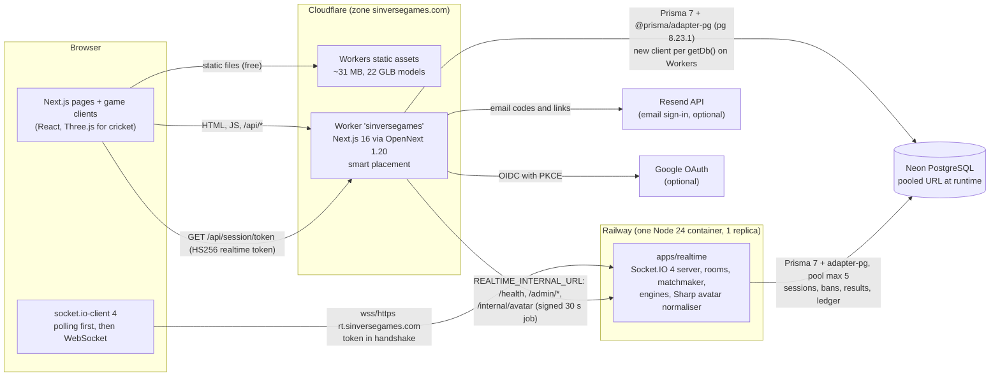

# SinverseGames: current infrastructure architecture

Taken from the code on `feature/unified-platform` at `17c58f4` (2026-11-14), not from earlier descriptions.

**Read-only.** Nothing was changed, deployed or created. No dashboard (Cloudflare, Railway, Neon, Resend) was accessible, so live settings, usage and bills are not shown here. Where a fact depends on them, it is marked **unverified**.

## Components and how they connect

| From | To | What, and where in the code |
|---|---|---|
| Browser | Worker | Every page and API route. `force-dynamic` data pages query Neon on most requests (`wrangler.jsonc` comment). Solo games are verified here by replaying their logs (`/api/solo/submit`) |
| Browser | Static assets | `_next/static`, `public/` (21 MB, 26 files: GLB athletes, covers). [Free and unlimited](https://developers.cloudflare.com/workers/static-assets/billing-and-limitations/); there's no `run_worker_first` |
| Browser | Worker → realtime | The browser fetches a short-lived HS256 token from `/api/session/token`, then connects Socket.IO to `NEXT_PUBLIC_REALTIME_URL` (`https://rt.sinversegames.com`, DNS-only CNAME to Railway per `DEPLOYMENT.md`). The CSP `connect-src` allows exactly that origin |
| Worker | Realtime | `REALTIME_INTERNAL_URL`, server to server: - `/health`, for `/api/health`; - `/admin/metrics`, `/admin/rooms/:code/close`, `/admin/players/:id/kick`, for `/admin`, with `ADMIN_TOKEN`; - `/internal/avatar`: **Sharp/libvips image normalisation**, a native module that can't run on Workers |
| Worker | Neon | `packages/db/src/client.ts`: on workerd, **each `getDb()` call creates a new `PrismaClient` with its own `pg` pool (max 1)**. There are 30 `getDb()` call sites in 22 web files; `lib/server/session.ts` alone has 4 |
| Realtime | Neon | On connect: account-session or player-kind lookup, plus a ban lookup (cached 60 s). During play: **a background account recheck at most every 5 s per active socket** (`account-guard.ts`). At match end: `recordMatch` (results, stats, XP, achievements, Sin Coins ledger, in one transaction), with 3 retries |
| Worker | Resend | Email sign-in, if `RESEND_API_KEY` and `EMAIL_FROM` are set. **Whether production sets them is unverified** |
| Worker | R2 | **None in production.** `avatar-storage.ts` looks for an `AVATARS` R2 binding, which `wrangler.jsonc` doesn't declare, so custom avatar uploads report "unavailable" outside local test fixtures |

## The realtime server (`apps/realtime`, 1,557 lines)

| Part | Behaviour |
|---|---|
| `server.ts` | Node `http` server plus Socket.IO 4: - **transports `websocket` and `polling`**; `maxHttpBufferSize` 32 KB; ping 15 s, timeout 20 s; - CORS from `ALLOWED_ORIGINS`; - per-IP connection cap 30; - `io.use` verifies the signed token, account and ban; - `socket.use` runs the per-packet account guard; - events are registered through one wrapper: token-bucket rate limit, Zod envelope and payload validation, an **acknowledgement callback**, and error containment; - also hosts `/health`, `/admin/*` and `/internal/avatar` |
| `rooms/room.ts` | A room owns its members, lobby, the authoritative engine state, a per-member outbound sequence number, idempotent action ids (last 64), reconnect grace timers (60 s), auto-start for public rooms (5 s), engine tick timers (`nextDeadline`/`tick`), per-player views (`viewFor`) and match end. "Node's event loop runs each handler to completion": actions are serialised per room |
| `rooms/room-manager.ts` | **All rooms in one process's memory.** - The `player → room` index (one room per player). - Codes: 6 characters from a 31-letter alphabet. - A sweep every 15 s: empty rooms after 60 s, finished rooms after 5 min, idle lobbies after 30 min. Cap of 5,000 rooms. - Persists results after the match, asynchronously |
| `rooms/matchmaker.ts` | One queue per game. Players first join an open public lobby, otherwise the queue forms a room at the target size (Chef Rivals 2, Kitchen Rush Co-op 3, Color Clash 4, Token Trail 4, Doodle Duel 6, Bumper Blitz 6) or after 8 s at the minimum size. A 1 s interval timer |
| `avatars.ts` | Sharp: JPEG/PNG/WebP ≤ 5 MB, ≤ 4096 px, animation rejected. Produces 64 and 256 px WebP with metadata stripped. Two at a time, one-use signed jobs |
| `account-guard.ts`, `persistence.ts`, `rate-limit.ts` | Revocation without a database read per packet; result retries; per-category limits: game input 30/s, strokes 60/s, cooking 14/s |
| Restarts | **Every room is in memory.** A restart or deploy closes all rooms with "shutdown" (`index.ts`). One replica (`railway.json`) |

### Socket.IO features actually used

| Feature | Used? | Where |
|---|---|---|
| WebSocket transport | Yes | |
| **HTTP long-polling transport, polling-first with upgrade, `tryAllTransports`** | **Yes**, deliberately: the takeover fixed gateway failures this way | `apps/web/src/lib/realtime/connection.ts` |
| Handshake auth callback (token fetched per attempt) | Yes | client `auth: (cb) => …`, server `io.use` |
| Server middleware per packet (`socket.use`) | Yes | account guard |
| **Acknowledgements with client timeouts** (request/response) | Yes, for every client event | client `socket.timeout(ACK_TIMEOUT_MS).emit(…, cb)` |
| Automatic client reconnection with backoff (0.5–5 s) | Yes | client options |
| Heartbeat ping/pong | Yes (Engine.IO, 15 s / 20 s) | |
| `io.fetchSockets()` | Yes, for the admin kick | `server.ts` |
| Socket.IO rooms, `io.to()`, namespaces, adapters (Redis etc.), binary, connection-state recovery | **No.** The app's own `Room` sends to each member's socket, and its own `seq` and `room:sync` handle gaps and resync | |
| Compression | Long-polling: on (`httpCompression` default `true`). **WebSocket: off** (`perMessageDeflate` default `false` since v3; not overridden) | [Socket.IO server options](https://socket.io/docs/v4/server-options/) |

## Multiplayer games and their traffic

Measured on 2026-11-14 with the real engines in Node, server side only. Bytes are the JSON envelope the room actually sends: payload, plus id, room, match, seq and time.

| Game (id) | Players | Server timing | Measured outbound | Notes |
|---|---|---|---|---|
| **Bumper Blitz** (`bumper-blitz`) | 2–6 | **50 ms tick (20 Hz)** for the whole match | **≈ 228 KB/s per 6-player room, 129 messages/s** (about 1.8 KB per view, to every player every tick). CPU about 0.05 ms per tick, **about 0.1% of one core** | About 20 MB per 90-second match. Per-message deflate shrinks these messages **3.16×** (1,818 B to 575 B) |
| **Kitchen Rush Co-op** (`kitchen-rush-coop`, the "Kitchen Rush multiplayer") | 2–4 | Sync every 500 ms | 12 KB/s with no actions (2.3 KB views), **plus a full view to everyone on each action** | Estimated about 74 KB/s while cooking |
| Chef Rivals (`chef-rivals`) | 2 | Sync every 1 s | 6 KB/s with no actions (3.0 KB views), plus actions | Estimated about 42 KB/s |
| Color Clash (`color-clash`) | 2–4 | Turn timer | 0.2 KB/s idle; one 1.6 KB view per player per action | Turn-based |
| **Token Trail** (`token-trail`, the **Ludo-style** game) | 2–4 | Turn timer | 0.2 KB/s idle; 0.9 KB views | Turn-based |
| Doodle Duel (`doodle-duel`) | 2–8 | Round timers | 0.4 KB/s idle; **strokes relayed to every viewer**, up to 60 a second from the drawer | Estimated about 23 KB/s while drawing |

**CPU isn't the constraint anywhere. Outbound bandwidth is, and Bumper Blitz accounts for about two-thirds of it in an even game mix.**

## Database use (`packages/db`)

- **Prisma 7.10.1** with `@prisma/adapter-pg` and `pg` 8.23.1.
  - Node keeps one cached client (pool `DATABASE_POOL_MAX`, default 5).
  - workerd builds a new client per `getDb()` call (pool max 1).
- **Neon pooled URL** (`-pooler`, PgBouncer) at runtime on both the Worker and Railway; the direct URL is used only for migrations (`DEPLOYMENT.md` § 2).
- **Schema:** 4 migrations: players and identity, matches and participants, stats, achievements, the append-only Sin Coins ledger, cosmetics, the Cuisine Quest campaign, sessions and OAuth attempts, rate limits.
- **Recorded production size:** 9 players, 8 matches, 16 participants, 14 achievements, 11 stat rows and 23 ledger rows at the 2026-11-05 migration (`PRODUCTION_MIGRATION_READINESS.md`). Current figures are **unverified**.
- **What keeps Neon awake:**
  - page requests;
  - `/api/health` (`SELECT 1`, plus a realtime fetch);
  - realtime connects;
  - the 5-second account recheck while anyone plays;
  - match results.
  - Any uptime monitor on `/api/health` also wakes it.

## Deployment pipeline

- **Web:** Workers Builds builds `main`:
  - `pnpm cloudflare:build`, then `pnpm cloudflare:deploy`, guarded to `main`;
  - non-production branches run `pnpm cloudflare:preview:deploy`;
  - Node 24.14.0, pnpm 11.15.1, Wrangler 4.155.0.
- **Realtime:** Railway builds `main` from `apps/realtime/Dockerfile`:
  - `watchPatterns` include `apps/realtime/**`, `packages/**` and the root manifests;
  - health check `/health`; draining 15 s; restart on failure.
- **DNS:** a Cloudflare zone, with apex and `www` as Worker custom domains, and `rt` as a DNS-only CNAME to Railway (`DEPLOYMENT.md` § 5; live records **unverified**).

## Environment variables by runtime

See `CRICKET_ENVIRONMENT_CHECKLIST.md` for the full list. The realtime service reads:
- `AUTH_SECRET`, `ADMIN_TOKEN`, `ALLOWED_ORIGINS`, `DATABASE_URL`;
- `PORT`, `HOST`, `NODE_ENV`, `LOG_LEVEL`;
- `RECONNECT_GRACE_MS`, `ROOM_IDLE_MS`, `FINISHED_ROOM_TTL_MS`, `EMPTY_ROOM_TTL_MS`, `MATCHMAKING_WAIT_MS`, `MAX_ROOMS`, `MAX_CONNECTIONS_PER_IP`.

The Worker additionally uses `REALTIME_INTERNAL_URL` and `NEXT_PUBLIC_REALTIME_URL` to reach it.
