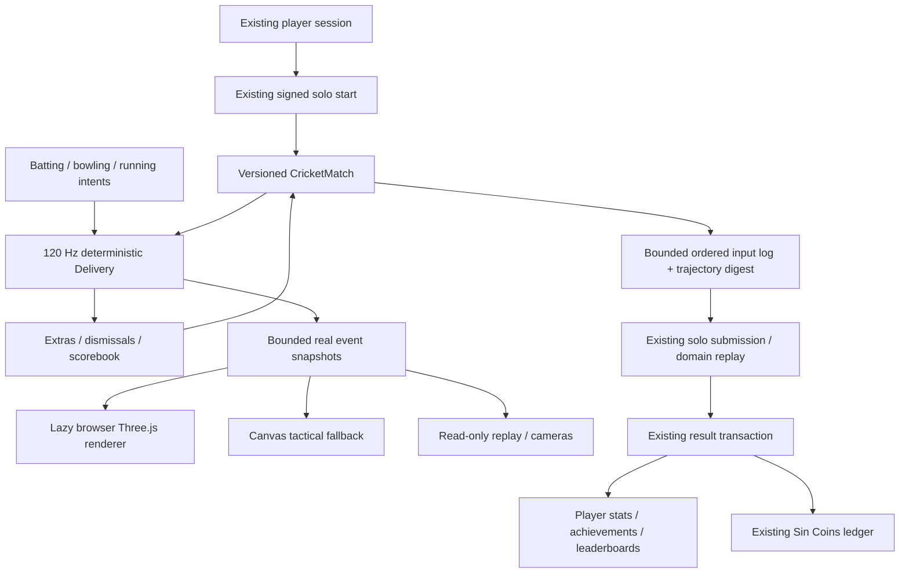

# Sinverse Cricket architecture

## Existing platform audit

Initial clean branch `codex/takeover-and-reliability-audit`, HEAD `920b22d0485b40d0a1316cdf0ffd78a04b3be6ea`. Earlier Cuisine Quest `14ac4ef`, identity `fed214f`/`53b2851`, Node pin `5304115` and Preview fix `920b22d` remain ancestors. Both root manuals were read and compared; Next's installed client/deployment guidance was inspected. Relevant architecture, deployment, gameplay, Cuisine Quest, expansion, identity, takeover and reliability reports were inspected against actual paths. Historical report claims do not authorize external actions.

The actual catalogue contains eight playable games (four realtime, four solo), including the completed seven-kitchen/28-recipe Cuisine Quest campaign. Existing solo engines use seeded replay and strict schemas; realtime engines use synchronous intent reducers, injected time/RNG and per-player views. Socket.IO rooms retain server clocks, match UUID scoping, persistence and expiry. Cricket adds no new socket stack or room mode.

Player/ExternalIdentity/AccountSession/OAuthAttempt preserve guest linking, usernames, avatars and revocation. PlayerGameStats/Match/MatchParticipant, achievements, cosmetics, CuisineProgress and the append-only RewardLedgerEntry already own progression. Four existing migrations establish this schema. Cricket uses string game IDs in existing tables; no migration or new career table is required for this slice.

The web runs Next 16.4.3/OpenNext 1.20.14 on Workers; the Node realtime service runs on Railway with native Sharp external to its bundle. Node remains 24.14.0, pnpm 11.15.1 and Wrangler 4.155.0. The existing production/Preview commands and Worker bindings are preserved. Original tests cover engines, real sockets, PostgreSQL rollback/concurrency and 35 browser flows including the full Cuisine Quest campaign. The fresh pre-change baseline passed all 200 unit/integration cases.

## Data flow

`domain.ts` defines strict finite schemas, explicit duel rules and transport-free data. `rules.ts` independently reduces scorebook outcomes. `physics.ts` integrates ball/fielders/runners at 1/120 second, quantizing positions to micrometres. `match.ts` handles turn ownership, seeded opposition, scorecards, innings and verifier. React, Three, audio, browser time, GPU APIs and database clients never enter this domain.

The client records actual input ticks, sequence, role-specific controls and end times. Server replay reconstructs ball outcomes and rejects unfinished games, wrong roles, bad sequences, invalid timing, stale/unused intents and trajectory disagreement. The short digest is a diagnostic consistency check, not a cryptographic authorization mechanism. Existing run-token signature, player ownership, unique match UUID and ledger transaction provide authorization/idempotency. Seeded solo replay cannot prove human input or prevent every bot.

Local rendering consumes snapshots, not authoritative scores. The client retains at most six delivery replays, each at most 565 frames (one every three ticks plus endpoints), including ball/field positions, travel/action state, runner progress and grounding. Replays interpolate those original snapshots; changing camera/speed/scrub cannot mutate the match. Server verification disables frame capture. Cross-engine floating-point identity is verified where tested, not promised for arbitrary future JS runtimes; snapshots preserve the local event path independently of reconstruction.

## Rendering decision and budgets

Three.js **0.187.0**, MIT, is the only added direct runtime dependency. Matching `@types/three` is development-only; its type-support dependencies (including Rapier compatibility types) are not used as game physics. Core Three is dynamically imported only when a 3D match starts. No React Three Fiber, Babylon, physics middleware, model pack, remote texture, native decoder or WebGPU requirement is added. Cloudflare-only output-file trace exclusions prevent unused Three example/decoder files entering the Worker; the actual renderer stays in lazy static client chunks. Local Worker routes and final packaging verify this boundary.

[Three's WebGL renderer requires WebGL2](https://threejs.org/docs/pages/WebGLRenderer). The first slice chooses that established path over a second WebGPU implementation. WebGL2 detection/context loss and quality changes must keep the game playable through tactical Canvas2D. A failed renderer never substitutes a static promotional image for play.

Original cross-section loft meshes attach to articulated bones; close players have pads, gloves, helmet/grille, bat, fabric and number/name textures. Fielders use fewer details. Leg phase follows recorded motion and batting/bowling poses follow ticks. Stands, a mown outfield, worn pitch, creases, actual-dimension stumps/rope, screens, original boards, floodlights and instanced crowds are constructed locally. Ball and cameras track simulation data. Player animation remains procedural and approximate, not a licensed motion-capture rig or scientific bat-mesh collision solver.

Quality ladder: low/medium/high/ultra cap DPR at 1/1.25/1.5/2, crowd instances at 450/1000/1900/3000, and shadow maps off/off/1024/2048. One scene/RAF controller per match; resources, observers, context listeners and audio loops must be released on unmount or replacement. Budgets to assess: <=500 draw calls at high, <=250k triangles, <=45 textures, <=40 MiB retained game state; targets 60 fps capable desktop and 30 fps low mobile. Actual headless/software-GPU measurements and deviations belong in QA; these are not hardware guarantees.

## Audio, persistence and multiplayer boundaries

Reuse platform WebAudio/settings: a backward-compatible master level, separate crowd loop routed through master, existing effects/music buses and original cricket impact sounds/motif. Gesture unlock, pause, mute, failure and unmount remain graceful. Text supplies important event information.

Three new achievements extend the existing list. Generic match/profile/ranking APIs persist verified results. The only score-repository behavior extension is neutral win/loss accounting for an explicitly tied cricket result. Existing game behavior remains unchanged. No arbitrary client coin amount or cosmetic entitlement is introduced.

Future multiplayer must run this domain on the existing Node/Socket.IO server, receive bounded tick/sequence inputs, withhold future bowling randomness, reconcile snapshots and enforce server ownership/disconnect rules. No synchronous cricket multiplayer, server live tick loop, matchmaking, ranked season or network prediction has shipped in this milestone.
